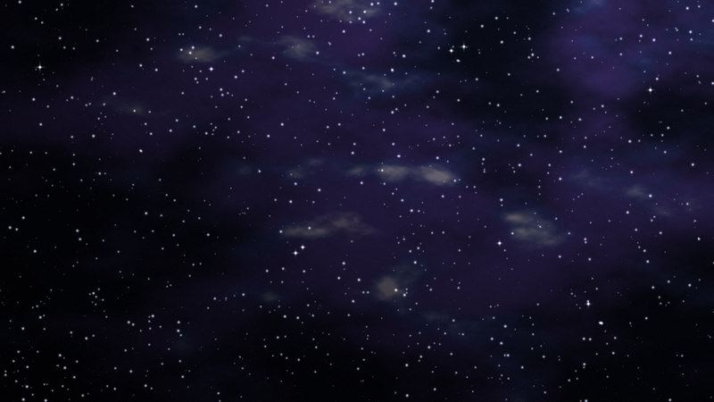

# dsh-theme-astral

DeepSeek Harness 的星穹铁道风格主题「星穹·夜航」——深空蓝金，星空作底。

> 非官方作品，与米哈游（miHoYo / HoYoverse）无关。仓库内不含任何游戏原始美术资源，
> 图形均为手写 SVG 或用脚本生成的位图，详见 [素材与版权](#素材与版权)。



## 它长什么样

- **底**：深空蓝 `#0A0E1A`，程序生成的星云照片压在底层，上面叠星点、两团极淡的辉光、
  两道轨道弧和一层暗色罩（让照片退成景深而不是贴纸）。
- **面**：助手卡片是冷调 `#141E33` + 左缘 2px 金条 + 内缩 4px 的第二道细线 + 左上/右下切角；
  用户气泡镜像成暖调 `#1B2130` + 右缘金条；输入框做成车厢窗框（9px 金属框、四颗铆钉、玻璃面）。
- **线**：所有 0.5px 细线统一成暖炭灰，分区线两端渐隐，分区中点嵌一颗菱形"站点"。
- **饰**：四角 HUD 括角、右缘刻度轨、侧栏纵向线路图、顶部刻度条、坐标戳、票根条码。
- **字**：标题带金色小节号与菱形，列表标记是菱形，链接金色，代码块用整套 shiki 换色。
- **动**：切换时一道斜向跃迁光带 + 虹膜雾 + 四颗菱形火花。

配色覆盖约 96 个 `--dsw-*` token（表面、描边、文字、状态、按钮、markdown、浮层、滚动条），
外加 27 个字形 × regular/medium = 54 枚自绘图标。

## 安装

主题是标准的 DSH 本地 bundle，以 link 方式装进 profile：

```powershell
# 1. 克隆到任意目录
git clone https://github.com/<用户名>/dsh-theme-astral.git

# 2. 在 profile 里 link
cd $env:USERPROFILE\.dsh\profiles\desktop
npm install link:<仓库绝对路径>
```

然后在 profile 的 `package.json` 里把包名加入 `dsh.profile.bundles`：

```json
"dsh": { "profile": { "bundles": ["@local/dsh-theme-astral"] } }
```

重启 Harness，控制台应出现：

```
[astral] 主题已加载 v1.0.0 · 图标 54 个 · 模式 night
```

## 开关

三种方式，都指向同一个 `toggleMode()`：

- 右缘菱形按钮（悬停出现）
- `Ctrl + Alt + T`
- 双击侧栏左上角品牌徽记

模式存在 `localStorage['dsh.astral.mode']`，取值 `night` / `off`。

## 换自己的底图

1. 打开 **设置 → 通用**，滚到底部「背景图」一行
2. 点「更换图片…」，选一张本地图片（jpg / png / webp，建议横图）

图片只存在本机浏览器的 `localStorage`，不会上传。点「还原默认底图」撤销。
过大的图会被缩到最长边 1920 再压成 JPEG 质量 0.82，避免撑爆 5MB 配额。

## 已知限制

- 主题 id 无法写进宿主偏好（宿主只持久化 `system` / `light` / `dark`），所以插件自带一层
  `reassert()`：检测到偏好被重置回内置值就重新 `setTheme`，上限 12 次/60 秒。
- 热重载时新旧实例会短暂并存。实例带 `OWNER` 标记，旧实例卸载时不清理 DOM，
  避免把新实例刚画好的东西抹掉。
- 宿主组件类名带构建哈希。稳定的钩子（`data-message-bubble`、`data-chat-flow-kind`、`[class*="_xxx"]`）
  优先使用，哈希类名只作补充；改版后最多是那几条规则不生效，不会报错也不会白屏。

## 测试

```powershell
node --check client.js
node test/icons.mjs        # 5 项：图标键数、SVG 合规、文档齐全、字形成对
node test/persistence.mjs  # 10 项：偏好被重置后的自愈、关闭后不抢偏好
node test/hot-reload.mjs   # 4 项：实例并存时的接管与上色
```

`icons.mjs` 正常时 exit 0 且 0 个 FAIL（不打印 ALL PASS），另外两套会打印 `ALL PASS`。

## 素材与版权

- `assets/bg-night.jpg`：Python 脚本生成的多倍频值噪声星云，无外部素材。
- 所有图标、徽记、星轨、刻度均为手写 SVG 路径。
- 配色取自公开截图的采样与官方宣传文字的描述性信息，不含任何原始美术文件。
- 名称与描述不暗示官方出品。若权利人认为有不妥之处，请开 issue，会立即调整。

## License

MIT